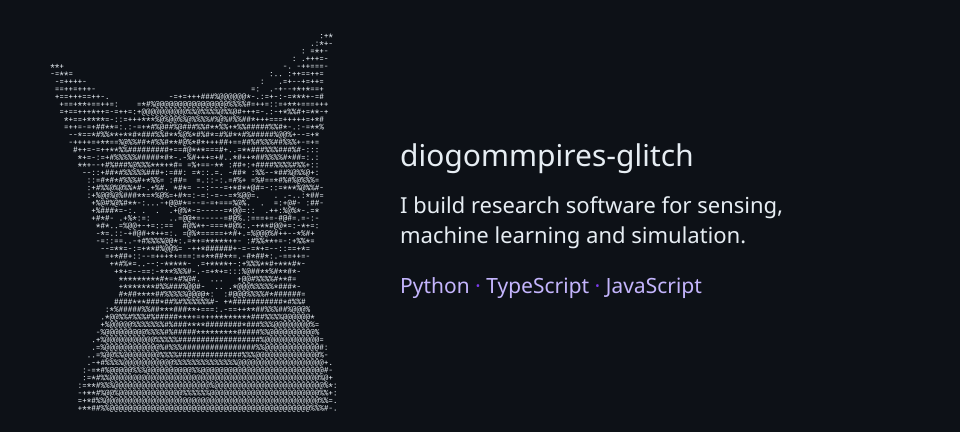

# diogommpires-glitch

<picture>
  <source media="(max-width: 640px)" srcset="assets/profile-mobile.svg">
  
</picture>

I build research software for sensing, machine learning and simulation. These eight public source snapshots include experiments, evaluation tools and the limits of the work.

| Project | What it explores |
| --- | --- |
| [CrossVenue](https://github.com/diogommpires-glitch/crossvenue-publication) | Market-making research, paper trading and deterministic replay |
| [Sensor Fusion](https://github.com/diogommpires-glitch/sensor-fusion-publication) | Multi-sensor positioning and state estimation |
| [Human Emotion](https://github.com/diogommpires-glitch/human-emotion-publication) | Spiking emotion-circuit simulation |
| [Wavepacket](https://github.com/diogommpires-glitch/wavepacket-publication) | Numerical quantum dynamics |
| [DodoVisionAI](https://github.com/diogommpires-glitch/dodovisionai-publication) | Experimental multimodal signal processing and presentation-attack detection |
| [PAD identity leakage](https://github.com/diogommpires-glitch/pad-identity-leakage-publication) | Identity-overlap and benchmark split audits |
| [SECOM Quality Lab](https://github.com/diogommpires-glitch/secom-quality-lab) | Semiconductor inspection prioritisation |
| [Dodo Mem](https://github.com/diogommpires-glitch/dodo-mem) | Evidence-linked memory and bounded retrieval |

Project links and card facts reflect the public snapshots on 12 November 2026. Windows and Linux are CI targets across the collection; individual repositories document their own coverage.

<details>
<summary>About the portrait</summary>

The portrait is a local, deterministic ASCII conversion of my GitHub avatar. Both cards contain SVG text and shapes, with no scripts, external images or font downloads. The source photo is not distributed here.

To rebuild the cards, use Python 3.11 or later with Pillow 13.0.0 and supply the same authorised 300 × 300 avatar locally.

```sh
python scripts/generate_profile.py /path/to/avatar.png
```

</details>

Original work is available under the [PolyForm Noncommercial licence](LICENSE). See [LICENSING.md](LICENSING.md) for the scope and third-party terms.
